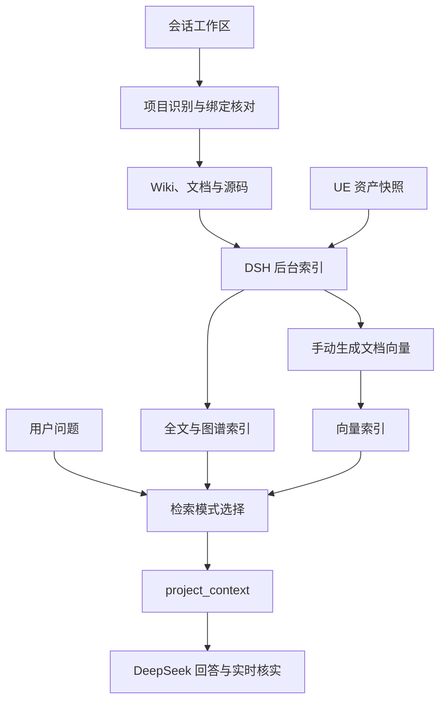

# DSH Unreal Bridge：Wiki 与可选向量检索实现大纲

版本：v1.0

日期：2026-11-27（北京时间）

适用项目：dsh-unreal-bridge

文档性质：设计与实施大纲；第 3 节保留规划时的代码基线。

实施进度（2026-11-27）：M0 已完成，见 [基线与回归样本](docs/knowledge-baseline.md)；M1 已完成，见 [DSH 项目与知识服务](docs/knowledge-m1.md)；M2 已完成，见 [Wiki 与文档基础](docs/knowledge-m2.md)，后续独立的 [文本型 PDF 解析与页码引用](docs/knowledge-pdf.md) 也已交付；M3 已完成，见 [设置与云端向量](docs/knowledge-m3.md)；M4 已完成，见 [混合检索与图谱关联](docs/knowledge-m4.md)；M5 已完成，见 [UE 快照协作与分发验证](docs/knowledge-m5.md)。独立导出、显式导入、离线资产证据与 Wiki 关联已通过真实 UE 5.8.4 联调，Win64 DLL、干净 DSH 安装及三种 Node 运行时已验证。PDF 支持物理页码、文本回读和无文本页 OCR 提示；OCR、真实模型质量与工程规模性能仍待后续专项验证。

## 1. 已确定的需求与默认行为

本扩展以 DSH 插件为知识服务的管理端，以 UE 插件为资产信息与实时状态的提供端。使用 Wiki 维护工程内的 ProjectKnowledge；在现有全文检索和 ProjectGraph 的基础上，按需增加云端 Embedding 与向量检索。

必须遵守以下产品约定：

1. Embedding 的服务地址、模型与 API Key 在 DSH 插件设置页配置，不要求用户在 UE 工程中配置密钥。
2. 设置页提供明确的“生成/更新向量索引”按钮，用户点击后才为目标项目的文档生成向量。默认不自动启动付费文档向量化。
3. 保存配置、打开工作区、打开设置页、开始聊天、连接 UE，都不自动生成或重建文档向量索引。
4. 未配置或关闭 Embedding 时，继续使用原有流程：全文检索 + ProjectGraph 定位代码和资产 + DeepSeek 回答。
5. 配置成功但尚未生成有效索引时，同样使用基础检索，不要求用户先完成向量化才能继续工作。
6. 向量检索异常不得使全文检索、图谱查询或 UE 实时工具整体失效。
7. ProjectKnowledge 是可维护、可版本管理的知识源；索引和模型生成的摘要是派生数据。
8. 本期不改动游戏运行时；知识处理继续属于 DSH 后端和 UE 编辑器工具。

“点击生成”约束的是文档向量索引构建。启用且存在可用索引后，语义检索通常仍需调用 Embedding API 生成当前问题的向量；相同问题可按配置缓存。这不是重建文档索引，也不是启动第二个对话 Agent。

## 2. 范围与交付边界

### 2.1 首版交付

- 文件型 Wiki：沿用 ProjectKnowledge 目录，增加页面元数据、别名、页面链接和实现关联。
- DSH 端知识服务：项目识别、后台索引任务、进度、取消、恢复和查询路由。
- 基础检索保持可用：全文检索、源码搜索、ProjectGraph、来源回读。
- 一个可配置的云端 Embedding 适配器；协议与模型通过显式能力检测确认。
- 本地向量存储、全文与向量混合检索、增量向量缓存。
- 从 Wiki / 文档关联到源码和 UE 资产，统一组装 project_context。
- 文本型 PDF 的解析与页码引用可作为首版文档接入子阶段，独立于向量主链路交付。
- 设置页中的 Embedding 配置、测试连接、项目选择、手动生成索引和状态展示。

### 2.2 后续扩展

- 在线 Wiki 平台、多人编辑、远程双向同步。
- 扫描 PDF 的 OCR、复杂版面与图表识别；其服务和费用独立配置。
- PDF / 文档转 Wiki 草稿，以及 AI 辅助维护页面。
- 本机或内网 Embedding 服务、可选重排模型。
- 类 / 函数级源码向量化，以及蓝图和材质的结构化文字摘要向量化。
- 用户明确启用后的自动向量索引更新。

首版不默认向量化整个 UE 引擎、全部资产 JSON 或所有历史日志。先覆盖选定的 Wiki 与项目资料，降低构建成本并便于评测。

## 3. 当前代码基础与已确认缺口

以下结论来自当前仓库源码检查。中文检索和重复文档 ID 问题在插件自带 Node 环境中进行了内存数据库验证；没有执行真实云端 Embedding 或完整工程性能测试。

| 现有部分 | 已确认的行为 | 扩展要求 |
| --- | --- | --- |
| DSH 设置 | settings.mjs、settings-client.mjs 已接入官方配置表单；现有通用字段主要是数字和布尔值 | 支持字符串、选择项、模型配置和专用密钥交互，保留现有配置版本冲突处理 |
| 会话工作区 | index.mjs 已使用 workingDirectory；skills.mjs 已实现工程定位和本机路径映射检查 | 提取统一的项目上下文解析服务 |
| 知识调用 | unreal_knowledge 当前转发给绑定 UE 的 knowledge_call | 按工具类型拆分为 DSH 本地知识处理与 UE 实时处理 |
| 文档索引 | 每份文件对应一个 DocumentRecord | 增加有来源位置的片段级索引 |
| 分块配置 | 配置中存在 targetChars=1800、overlapChars=180 | 当前索引未使用这两个参数，需要真正接入分块 |
| 向量索引 | vectorIndex.ts 中 enabled=false，search 返回空数组 | 实现向量存储与查询，按需加载 |
| 混合检索 | hybridSearch.ts 当前只调用全文索引 | 增加独立向量召回和结果融合 |
| 中文全文检索 | 连续中文句子中的“唤醒”等子串可能无法命中 unicode61 文档索引 | 改善中文分词或辅助词项；与现有源码搜索逻辑统一评测 |
| 文档身份 | ID 使用内容哈希前缀；内容相同而路径不同的文件会触发主键冲突 | 分离页面身份、内容版本、片段身份与向量缓存键 |
| 排序 | 部分 ProjectKnowledge 目录固定加 5～8 分 | 避免目录权重压过相关性，不能直接相加 BM25 与向量分数 |
| 编辑器更新 | 资产快照导出后启动 Worker，执行全量 buildMemory / buildGraph | 拆出快照发布；由 DSH 调度文档增量与图谱构建 |
| 增量实现 | updateMemory 可复用部分解析结果，全文库仍重建 | 区分解析复用、全文增量和向量增量 |
| 来源回读 | read_source 以文本文件为主 | 增加 read_document / read_chunk，支持办公文档与 PDF 定位 |
| 运行环境 | UE 工具固定 Node 24.15.0；DSH 包声明 Node >=22 | 验证宿主实际能力，不能假定可直接迁移 SQLite / DLL 依赖 |
| 设置页作用域 | 全局设置页没有所属会话；现有 remote.mjs 已区分全局与会话接口 | 索引按钮必须携带明确目标项目，不能猜测“当前会话” |

另需注意：当前 project_context 会进行源码扫描；引入向量不自动消除这部分 IO。应先查索引和明确关联文件，再按需要扩大源文件搜索。

## 4. 总体架构与职责

| 层次 | 所在位置 | 职责 |
| --- | --- | --- |
| 知识源 | UE 工程 / 已授权工作区 | ProjectKnowledge、Docs、表格、PDF 和源码 |
| Wiki 维护 | DSH 提供入口，文件仍在工程内 | 编辑、导航、关联、状态与来源管理 |
| 项目上下文 | DSH 后端 | 工作区、工程身份、绑定编辑器及权限核对 |
| 索引服务 | DSH 后台 Worker / 子进程 | 解析、分块、全文索引、图谱构建、向量写入 |
| Embedding 服务 | DSH 后端调用云端 API | 凭据解析、批处理、查询向量、限流与用量 |
| 资产提取 | UE 编辑器插件 | 蓝图、材质、资产注册表和其他结构化快照 |
| 检索与上下文 | DSH 后端 | 全文与向量融合、图谱关联、来源验证、预算裁剪 |
| 实时检查 | UE 编辑器插件 | 当前资产、场景实例、运行状态与资产操作 |
| 回答与规划 | DSH 当前对话模型 | 阅读证据，回答或继续调用工具 |

图中的文档向量化只由用户点击触发；查询向量由可用的语义检索路径按需生成。向量只用于检索，交给 DeepSeek 的是相关文字、代码、资产信息和来源。

## 5. 设置页与手动操作

### 5.1 设置分组

新增“知识库与 Embedding”分组，分为用户级服务配置、目标项目、索引操作三个区域。

| 字段 | 范围 | 约定 |
| --- | --- | --- |
| 启用语义检索 | 用户配置，可按项目禁用 | 默认关闭；不影响基础检索 |
| 配置名称 / profileId | 用户配置 | 供项目引用，不包含密钥值 |
| API 协议 / Provider | 用户配置 | 首版明确支持一种协议，保留适配器接口 |
| Base URL | 用户配置 | 明确完整 endpoint 拼接规则，避免重复追加路径 |
| Embedding 模型 | 用户配置 | 手动填写或受支持时列举；模型列表不能假定可用 |
| API Key | 本机用户级凭据 | 只供后端请求使用，不写入 UE 工程 |
| 输出维度 | 高级配置 | 默认使用模型返回值；只在服务支持时允许显式指定 |
| 请求超时、并发、批量上限 | 高级配置 | 受服务限制和总任务预算约束 |
| 目标项目 | 项目操作上下文 | 显示工程名、完整路径、绑定 UE 和快照状态 |
| 索引范围 | 项目配置 | Wiki、文档目录、排除项；不默认包含源码向量化 |

配置凭据优先使用经核实的 DSH 宿主凭据能力。M3 已验证 DSH 0.2.2-rc.5 的 credentials 记录接口；该宿主提供者不宣称加密保存。旧 Windows 宿主缺少记录接口时使用 DPAPI CurrentUser 加密回退。密码输入框遮罩本身不等于加密保存，具体边界见 M3 文档。

公开设置和状态只返回 credentialConfigured、配置名称等信息。普通 getConfig 快照、日志、审计、工具结果和 UE 通信不得携带密钥值。更换凭据不应直接改变向量空间身份。

### 5.2 操作按钮

| 按钮 | 行为 | Embedding API 调用 |
| --- | --- | --- |
| 保存配置 | 保存字段与凭据引用 | 不调用，不扫描文档 |
| 测试连接 | 使用固定的短测试文本检查鉴权、模型与维度 | 可发生一次小额调用；界面明确说明 |
| 生成/更新向量索引 | 为明确选择的项目计算新增、修改、缺失的片段向量 | 有，按实际未缓存片段批处理 |
| 重建向量索引 | 指定当前配置重新建立索引版本；明确显示范围和预计规模 | 只对确实缺失或明确要求重算的输入发起调用 |
| 取消任务 | 停止继续提交批次，保留可恢复结果 | 已提交的请求可能已经计费 |
| 继续未完成任务 | 用户点击后校验配置与来源，再继续缺失部分 | 有，仅继续需要处理的部分 |
| 更新基础索引 | 更新全文和图谱；按能力请求 UE 快照 | 不调用 Embedding |

“生成/更新”与“重建”分开；正常更新不强制重算所有向量。未保存配置时，构建按钮要求先保存，以已保存配置启动，并固定该任务使用的配置版本。

点击生成已经代表用户启动该范围的任务，不再增加重复确认。界面在按钮附近说明将向所配置服务发送选中资料片段；不自动上传整个工作区。

### 5.3 无会话的全局设置页

全局设置页不能只使用 sessionId 推断工程。建议使用 DSH 后端登记、已核验的 projectHandle 作为操作目标，提供明确项目选择器。

- 可从已知会话或已连接编辑器显示候选，但不能默认选择最近使用的另一个工程。
- 只有一个明确且可访问的候选时可预选，并持续显示完整路径。
- 多个候选、路径映射不明确或没有工作区授权时，要求用户选择可访问项目。
- 后端重新核对 projectHandle、访问范围和配置版本，不直接信任前端传入的任意绝对路径。

### 5.4 状态展示

展示当前检索模式、配置是否完整、索引模型、索引版本、最近更新时间、文件 / 片段数量、有效向量覆盖率、当前阶段、已处理数量、失败数量、可用旧版本、请求次数和服务返回的用量。

费用只有在已知服务价格与用量时才能计算；否则显示调用量或“费用请以服务商账单为准”，不编造金额。首版不自动拉取价格。

## 6. 检索模式与回退契约

基础模式固定为：

**全文检索 / 源码检索 → ProjectGraph 定位代码和资产 → project_context → DeepSeek 回答或继续核实。**

增强模式在此基础上增加向量召回，绝不以配置向量服务为使用插件的前提。

| 状态 | 文档向量化 | 查询行为 |
| --- | --- | --- |
| 未配置 / 配置不完整 | 不启动 | 基础模式；零 Embedding 网络请求 |
| 用户关闭语义检索 | 不启动 | 基础模式；即使有旧向量也不使用 |
| 已配置但尚未生成 | 等待点击 | 基础模式，不偷偷构建索引 |
| 首次生成中 | 后台执行 | 基础模式；完成发布后才使用新索引 |
| 有兼容、有效的已发布索引 | 仅点击更新时执行 | 全文 + 向量 + 图谱 |
| 更新中且旧版本仍有效 | 后台执行 | 可使用有效旧片段；已变化或删除片段不得作为当前证据 |
| 文档已变化 | 标记待更新 | 未变片段可用；变化部分走当前全文 / 原文，提示向量覆盖不足 |
| 模型 / 维度 / 输入格式不兼容 | 等待点击重建 | 基础模式；不能混用两个向量空间 |
| Key 被移除、401、超时、限流 | 按错误类型终止或有限重试任务 | 当前查询及时降级，不拖垮全文与图谱 |
| 向量库不可加载 / 损坏 | 保留可修复状态 | 基础模式，并提供可操作的状态说明 |

“基础模式”不代表无需基础索引或无需 UE。迁移前仍沿用原有绑定编辑器和已构建缓存的要求；迁移后，无 UE 时可查本地文档、源码图谱和带时间戳的历史资产快照，实时检查仍需要 UE。基础索引也缺失时，应明确提示更新，不隐式启动向量任务。

查询侧使用较短、可配置的向量分支等待预算。向量失败时已完成的全文结果仍然返回；服务持续异常时抑制重复失败请求。不能把“向量失败”转换为“项目不存在该能力”。

可选依赖必须延迟加载。无 Embedding 配置的普通用户，不应因为缺少向量 DLL、Provider SDK 或云端网络而无法加载插件。

## 7. 项目识别、缓存与双端边界

### 7.1 项目身份

- 会话工作区是入口，不使用插件进程的 process.cwd() 代替。
- 在工作区允许的访问范围内定位 .uproject；多工程时保留明确选择。
- 采用规范化真实路径与工程描述符标识本地工作副本；逻辑项目 ID 可另行保存。
- 不同工作副本 / worktree 不混用索引；同一工程多个会话共享已发布的持久索引。
- 使用 UE 快照、图谱关联或实时工具前，核对绑定编辑器的工程身份。
- Windows、WSL、容器路径须通过实际映射核验；不能仅按路径字符串相似认定为同一工程。
- 会话切换工作区或编辑器后，任务仍归属于创建时的工程；结果不能被投递给新工程。

### 7.2 数据归属

| 数据 | 建议位置 | 写入方 |
| --- | --- | --- |
| Wiki 和原始资料 | 工程 ProjectKnowledge / Docs 等目录 | 用户或授权的文档维护功能 |
| 项目索引策略 | 工程中的无密钥配置 | 用户或项目设置 |
| API Key | DSH 用户级凭据存储 | 专用凭据服务 |
| 全文 / 向量 / 图谱索引与任务记录 | DSH stateDir 下按项目分隔 | DSH 索引服务 |
| UE 原始快照 | 先保留现有 Cache/UE，按版本读取或复制 | UE 快照导出器 |
| 回答中保留的推断和经验 | 带来源、项目和版本的独立记录 | 现有知识记录工具及其迁移实现 |

Windows 缓存可采用现有 DSHUnrealBridge 用户数据目录下的 Knowledge/<project-id>/。这是拟议结构，不能据此假定现有目录已经存在。

持久资产快照记录 projectId、editorId、snapshotGeneration、capturedAt、覆盖状态和来源。未保存的实时对象信息按编辑器实例区分，不覆盖其他会话的项目事实。

### 7.3 单一写入方与迁移

每套索引只能有一个明确的写入方。迁移期可以保留旧 UE 查询回退，但 DSH 新索引与旧 UE 索引使用独立目录和版本，禁止同时改写同一数据库。

当前 Worker 耦合插件位置、Cache、项目身份与锁，不能原样作为宿主服务运行。先抽取不依赖进程入口的核心函数，再由 DSH 提供路径、凭据引用和任务上下文。模块仍在工程仓库维护，但通过 DSH 发布包明确打包，不能依赖用户工程内恰好存在另一份同版本工具。

## 8. Wiki、文档与来源规范

### 8.1 保留现有目录约定

| 路径 | 内容 |
| --- | --- |
| overview/project_purpose.md | 项目范围和概况 |
| architecture/architecture_rules.md | 架构约束 |
| systems/*.md | 系统职责、流程和实现入口 |
| patterns/*.md | 复用方案与推荐实现模式 |
| design/*.md | 功能设计与决策 |
| validation/ | 构建与验证方法 |
| troubleshooting/（新增） | 故障现象、排查方法、已确认原因 |
| glossary/（新增） | 术语、缩写、中英文别名 |

部分现有摘要读取固定路径，第一版不直接把全部内容迁移到额外的 wiki/ 子目录。后续可改为根据页面类型配置映射。

### 8.2 页面元数据

建议支持 id、title、type、status、aliases、tags、sources、symbols、assets、relatedPages。status 至少区分 draft、confirmed、deprecated；事实是否仍有效还要由来源版本核验，不能只相信手工状态。

页面正文包含职责、输入输出、流程、约束、异常处理、验证方法与引用。普通 Markdown 链接作为基础；双链语法如后续支持，应显式解析与验证。

Wiki 说明设计意图和约束，源码与 UE 状态反映当前实现。冲突时展示两者和来源，不把任何一个自动改写成另一个。AI 自动生成的草稿和已有 Evidence 推断，不能直接提升为已确认事实。

### 8.3 分块与定位

- Markdown：按标题层级、段落切分；尽量保持代码块、列表和小表格完整。
- DOCX：按标题 / 段落切分，保留可恢复的结构定位。
- Excel：按工作表和行组切分，重复必要表头，记录工作表名与单元格范围。
- PDF：文本型 PDF 提取正文和物理页码；印刷页码可作为附加字段，不混淆两种页码。
- 扫描 PDF：先标记需要 OCR；首版不把无文本页当作“没有相关知识”。OCR 后仍保留原页定位和识别状态。
- 长内容：分块目标同时受字符预算、结构边界和模型 Token 上限约束。

解析结果与最终引用使用原文位置，不以清洗后文本的行号冒充源文件行号。保留原始文档；摘要仅作导航，不能替代原文证据。

## 9. 核心数据与向量缓存

| 对象 | 最少字段 |
| --- | --- |
| ProjectContext | projectId、workingCopyId、workspaceHandle、工程路径、绑定编辑器、访问范围 |
| KnowledgeDocument | documentId、来源路径、标题、类型、状态、元数据、sourceHash |
| KnowledgeChunk | chunkId、documentId、正文、标题路径、来源位置、chunkHash、parserVersion |
| EmbeddingProfile | profileId、Provider、endpoint、model、维度、输入策略版本、credentialRef |
| EmbeddingRecord | chunkId 或映射关系、embeddingInputHash、profileFingerprint、向量、生成状态 |
| IndexManifest | generation、文档与向量覆盖、模型指纹、解析与分块版本、快照版本、构建时间 |
| IndexJob | jobId、projectId、requestId、配置版本、阶段、检查点、数量、用量、错误和结束状态 |

documentId 不使用内容哈希单独充当主键。优先使用 Wiki 显式稳定 ID，其余由项目与规范化相对路径确定。内容版本单独存储；改名时按规则迁移或重建映射。

向量复用依据“实际发送给模型的输入哈希 + 向量空间配置指纹”。标题、上下文前缀、输入类型等若参与 Embedding 输入，其变化也必须进入哈希。不同来源可以共享相同向量计算结果，但必须保留各自的来源映射。

同一维度不代表向量兼容。模型、服务语义、归一化、维度和输入模板改变时，建立新空间。更换同一服务的 API Key 不必自动重算全部向量；凭据访问权限仍需重新验证。

存储候选为 SQLite + sqlite-vec，正式选型前验证目标 DSH 运行时、Win64 扩展加载和分发。当前原生索引工具与宿主 Node 版本要求不同，必要时使用随 DSH 包分发的受控索引进程，不依赖 UE 目录中的 Node。基础检索不能依赖向量扩展成功加载。

M3 选型结果：使用独立 Worker 内的 SQLite BLOB 存储和有界精确余弦查询，首版不引入 sqlite-vec/DLL。后续是否引入近似索引或扩展，由 M4 的真实规模评测决定。

## 10. 构建与查询流程

### 10.1 点击生成 / 更新

1. 校验已保存配置、目标项目、工作区访问范围及用户选择的资料根目录。
2. 固定项目身份、配置版本和任务 requestId；同项目重复点击返回已有任务，不重复收费构建。
3. 扫描变化，解析文档并生成结构化片段，统计预计处理范围。
4. 对比已发布版本和持久向量缓存，复用输入完全一致的向量。
5. 为新增、修改、缺失片段执行批量 API 请求，验证响应数量、顺序映射、维度和有限数值。
6. 分批持久化检查点及用量；处理删除、重命名和失效来源。
7. 在新 generation 中构建对应全文、向量、来源映射；记录使用的图谱及 UE 快照版本。
8. 校验通过后发布新 manifest / 版本指针；失败不覆盖现有有效版本。
9. 返回状态、覆盖率、失败原因和继续操作入口。

如果图谱与文档分开发布，project_context 必须显式记录其版本组合并检查来源兼容性，不能把不同批次的数据伪装成同一时刻的项目快照。

任务存活不依赖单次模型工具调用的等待时间。点击启动后返回 jobId，界面读取状态。DSH 退出时停止新批次并保存进度；下次启动显示未完成任务，由用户点击继续，默认不自动恢复收费请求。

### 10.2 查询

1. 解析当前会话项目；需要 UE 时核对编辑器绑定。
2. 根据配置、已发布索引和来源状态选择基础或增强模式。
3. 执行全文、精确标识符和必要的源码检索。
4. 增强模式生成或复用查询向量，执行向量召回；文档向量索引不在此步骤生成。
5. 使用 RRF 等按排名融合的方式合并候选，去重并限制同页重复内容。
6. 从命中页面的 sources / symbols / assets 映射到 ProjectGraph，做有限关系扩展。
7. 校验来源是否存在、哈希及快照是否有效；必要时回读当前源码或请求 UE 实时检查。
8. 按总 Token / 字符预算组装 project_context，交给当前对话模型。

可从全文与向量各取 20 个候选、最终保留 8～12 个片段开始评测；这些只是初始参数。强规则、精确路径和相关性应分开处理，不能用固定目录加分掩盖低相关性。

不额外默认调用聊天模型改写每个查询或总结全部资料。确有收益时再加入可选功能，并单独统计成本。

### 10.3 返回信息

保留现有 project_context 的主要字段，向后兼容地增加 retrievalMode、degradedReasons、indexGeneration、profileFingerprint、引用定位、来源状态、命中渠道、耗时与用量。

read_document / read_chunk 支持按已验证来源 ID 回读解析片段。实时 asset_snapshot / inspect_asset 继续由 UE 执行。对调用方保留统一入口，但内部不再要求每个文档查询都绕经 UE。

## 11. 后台任务、错误与一致性

- CPU 密集的解析、图谱构建和同步数据库操作放到 Worker 或子进程，不阻塞 DSH 聊天与桥接事件循环。
- 使用项目级构建锁、有限全局并发和短发布锁，不在整个云端请求期间占用全部知识查询锁。
- 查询固定读取已发布 generation。Windows 下避免重命名仍被打开的数据库目录，采用新版本目录与指针发布，按读者引用回收旧版本。
- 发布前重核对已处理文件的版本；构建期间变化的文件重做或明确排除，不能将旧向量贴到新原文上。
- 401 / 不支持模型停止无效重试；429 / 临时网络错误有限退避；总尝试和时间均有上限。
- 取消后不继续提交新批次；服务端已经接受的请求可能仍完成并收费，界面如实说明。
- 持久缓存区分成功、失败和未完成批次，避免取消或进程退出后反复计算已成功内容。
- 配置变化不偷偷把正在运行的任务切到另一个模型。任务固定自己的配置版本；旧空间产物不能被标记为新配置就绪。
- 快照导出独立提供开始、状态、取消、完成版本和覆盖信息。DSH 只读取已发布快照，不使用导出中的半成品。
- 所有只读检索可降级；缺失证据不自动转换成否定结论。

## 12. 接口与代码改动清单

以下新增名称是建议，实施时依据项目命名统一。现有源码路径以仓库根目录为基准。

| 位置 | 改动 |
| --- | --- |
| src/settings-spec.mjs、settings.mjs | 新增 Embedding 配置类型、默认值、校验与配置版本语义 |
| src/settings-client.mjs | 新增配置表单、凭据状态、项目选择、测试与索引按钮、进度展示 |
| src/remote.mjs | 新增全局设置操作和项目级知识任务接口，显式传递 projectHandle |
| src/index.mjs | 注册 DSH 知识服务与生命周期，改造知识工具分发 |
| src/bridge.mjs、state-service.mjs | 项目绑定核对、快照交互、脱敏知识状态；保留实时工具路由 |
| src/skills.mjs | 抽取或复用工程发现、工作区权限和路径映射逻辑 |
| 新增 ProjectContextResolver | 工程身份与会话 / 设置页目标解析 |
| 新增 KnowledgeService / IndexJobManager | 索引注册、任务、进度、取消、恢复与发布 |
| 新增 EmbeddingProvider / EmbeddingService | 文档与查询向量、批次、缓存、重试和用量 |
| ProjectMemorySystem/src/sources | Wiki 元数据、结构位置、PDF 解析与可选 OCR 接口 |
| ProjectMemorySystem/src/index | 分块、文档 ID 修正、全文与向量维护 |
| ProjectMemorySystem/src/retrieval | 混合召回、融合、图谱种子与上下文预算 |
| ProjectMemorySystem/src/memory | 索引状态与版本、摘要依赖刷新、来源有效性 |
| ProjectGraph/src/commands | 支持宿主指定路径和快照版本，复用现有建图能力 |
| UE Knowledge 模块 | 将快照导出从“导出后必建图”拆开，增加任务与版本契约 |
| src/protocol.mjs、UE 工具目录、Worker 注册表 | 协同修改工具协议与能力协商，更新跨语言契约测试 |
| scripts/build.mjs、package-dsh.mjs 及检查脚本 | 打包共享核心和可选原生依赖，验证干净安装 |

新增宿主接口可包括：knowledgeProjects、knowledgeStatus、embeddingTest、knowledgeBuild、knowledgeCancel、knowledgeResume。名称不是最终协议；所有任务写操作具有幂等 requestId 和明确项目作用域。

保留现有 unreal_knowledge 对外入口；read_source、project_search、graph_query 等按迁移能力路由。已有 remember_evidence / experience_* 迁移时保留来源、语义和数据，避免因新索引重建丢失经验记录。

新增能力用协议版本 / capability 明确声明。旧 UE 插件缺少新版快照能力时，仍支持基础流程和已有快照，清晰提示可用范围。

## 13. 实施阶段与交付物

| 阶段 | 任务 | 验收门槛 |
| --- | --- | --- |
| M0 基线与回归样本 | 固定现有行为，准备中文、精确符号、文档和资产问题集 | 能复现当前结果；明确无 Embedding 的可用流程 |
| M1 DSH 项目与知识服务 | 抽取项目识别、核心索引、任务与查询路由；保留旧路径兼容 | 未配置时基础流程不退化，多项目不串数据 |
| M2 Wiki 与文档基础 | 元数据、分块、中文检索、ID、来源回读；文本 PDF 可单独交付 | 同内容文件不冲突，片段与原文位置一致 |
| M3 设置与云端向量 | 配置、凭据、测试连接、手动按钮、增量缓存、任务恢复 | 保存不构建，点击才生成，无配置零 Embedding 请求 |
| M4 混合检索与图谱关联 | RRF、精确匹配保护、来源过滤、图谱种子、Token 预算 | 自然语言召回改善且准确名称检索不退化 |
| M5 UE 快照协作与分发 | 独立导出、版本对齐、DLL / Node 验证、错误降级 | UE 断开可查已有知识，干净安装可运行 |
| 后续增强 | OCR、在线 Wiki、AI 草稿、源码向量化、自动更新选项 | 单独定义范围与成本，不影响默认手动模式 |

实现中可以让 M1～M3 部分交错，但每个阶段都必须保持“未配置 Embedding 仍可使用”的基线。不得以向量功能尚未完成为由让旧功能变为不可用。

## 14. 验收清单

### 14.1 设置与调用次数

- [x] 无 API Key 的隔离新配置与解包 Worker：普通知识查询正常，不调用 Embedding，也不要求安装向量扩展；M5 已完成隔离 profile 的官方安装及真实 Loader 验证。
- [x] 保存有效配置：不读取项目全文、不生成文档向量。
- [x] 测试连接：只发送固定短测试文本，不发送项目文件；显示调用结果。
- [x] 已配置但未构建：查询仍走基础模式。
- [x] 点击生成：仅处理所选项目与目录；重复点击不会创建重复任务。
- [x] 第二次点击且文档与配置均未变化：文档 Embedding 请求数为 0，允许必要的本地校验。
- [x] 只修改一个片段：只重算受影响的实际输入；删除文档后不再召回其旧片段。
- [x] 普通聊天不重建文档索引；语义查询的查询向量调用单独计量。
- [x] 关闭语义检索或移除 Key：立即回到基础模式，不继续新建查询请求；已提交请求可能计费。

### 14.2 正确性与隔离

- [x] 两份内容相同、路径不同的文件可同时索引，并保留独立引用。
- [x] 中文术语、英文类名、资产路径、中英文混合问题均有回归样本。
- [x] Wiki 命中可以定位到真实存在的源码 / 资产；M5 已用真实 Blueprint 快照验证资产关联，仍区分磁盘包证据与未保存实时状态。
- [x] 页面状态与来源有效性分开判断，不把陈旧 confirmed 页面当成当前事实。
- [x] PDF 引用保留物理页码和独立 PageLabels，按页内文本位置回读；扫描/无文本页提示需要 OCR 或可能为空白页，未执行 OCR。
- [x] 工作区 A 绑定 UE B 时不混合结果；切换绑定后的旧任务结果不会进入新会话目标。
- [x] 多会话共享同项目索引；M5 按工程和编辑器验证发布代，仅导入已保存资产，未保存实时对象不进入共享快照。
- [x] 模型 / 维度 / 输入模板改变后，不混用旧向量；只换 Key 不无条件全量重算。

### 14.3 稳定性与兼容

- [x] 401、429、网络超时、向量库损坏都能降级，全文和图谱不整体失败。
- [x] 构建、查询并发时读取的是完整发布版本。
- [x] 取消、宿主关闭后保留成功批次；重启不自动恢复收费任务；异常退出状态使用失活进程记录模拟验证。
- [x] 构建期间修改文件不会产生向量与原文错配。
- [x] 缺少新 capability 的旧 UE 路由以自动化覆盖；真实 UE 断开、快照过期返回明确状态，仍保留旧工具和有效文档证据。
- [x] 干净 DSH 安装、Node 22.23.5 / 24.15.0 / DSH 24.21.0、中文和空格路径得到验证；22.13 无 FTS5，已收紧运行要求。
- [x] 现有非知识库功能、设置保存、资产操作和会话绑定自动化回归通过；M5 真实 UE 联调 7/7、原生知识自动化 8/8 通过。

### 14.4 质量评测

对比当前检索、改进的全文检索、混合检索三组。使用同一问题集记录 Recall@10、关键引用准确性、无答案问题的处理、端到端耗时、模型输入 Token、文档向量与查询向量用量。性能目标在真实工程规模上测定，不预先承诺固定速度或召回提升比例。

M4 已提供 `npm run test:knowledge-m4`：同一发布版本运行原 13 题加 2 个改述问题，记录三组召回、引用回读、无答案、耗时、UTF-8 Token 上界估算及调用量。模拟服务的固定向量只验证集成行为；真实模型输入 Token、真实召回质量和 UE 资产评分仍待对应环境验证，详见 [M4 评估结果](docs/knowledge-m4.md#可复现评估)。

## 15. 实施前需要核实的技术点

这些是开发验证事项，不影响本大纲已经确定的产品行为：

1. DSH 当前可用的凭据接口、全局设置目标选择接口，以及后台任务退出生命周期。
2. DSH 宿主 Node 与 SQLite 能力，sqlite-vec Win64 扩展的加载和安装产物。
3. 首个 Embedding 服务的准确协议、模型输入限制、批量上限、维度与用量字段。
4. UE 快照增量导出、未保存资产标记和发布完成信号的现有可复用程度。
5. 实际工程文档量与问题集，以确定分块、召回、并发和预算参数。

## 16. 代码与技术参考

### 16.1 主要源码定位

- DSH 入口与路由：src/index.mjs、src/bridge.mjs、src/protocol.mjs。
- 设置与 UI：src/settings.mjs、src/settings-spec.mjs、src/settings-client.mjs、src/remote.mjs。
- 工程发现：src/skills.mjs。
- 现有 Worker：unreal/DSHUnrealBridge/Tools/knowledge-worker.mjs。
- 文档索引：unreal/DSHUnrealBridge/Tools/ProjectMemorySystem/src/index/documentIndexer.ts。
- 全文 / 向量：同目录 fullTextIndex.ts、vectorIndex.ts。
- 检索与组装：ProjectMemorySystem/src/retrieval/hybridSearch.ts、reranker.ts、contextPackBuilder.ts。
- 图谱：unreal/DSHUnrealBridge/Tools/ProjectGraph/src/commands/buildGraph.ts。
- UE 导出与进程服务：unreal/DSHUnrealBridge/Source/DSHUnrealBridgeKnowledge/Private/DSHUnrealBridgeKnowledgeModule.cpp、ProjectKnowledgeService.cpp。

### 16.2 外部设计参考

以下官方资料用于前期方案核对；最终依赖版本以实施时兼容性验证结果为准。

- [SQLite FTS5 文档](https://www.sqlite.org/fts5.html)：全文索引、BM25、分词器及短词限制。
- [sqlite-vec Node.js 集成示例](https://github.com/asg017/sqlite-vec/blob/main/examples/simple-node2/demo.mjs)：使用 node:sqlite 的加载与查询方式。
- [sqlite-vec JavaScript 文档](https://alexgarcia.xyz/sqlite-vec/js.html)：JavaScript 运行时集成入口。
- [Qdrant 混合查询文档](https://qdrant.tech/documentation/concepts/hybrid-queries/)：RRF 等结果融合方法参考，不代表本项目必须部署 Qdrant。

本期交付判断：用户可以完全不配置 Embedding，继续使用原有知识流程；配置并点击生成后，才在同一入口获得可追溯、可降级的语义检索增强。
